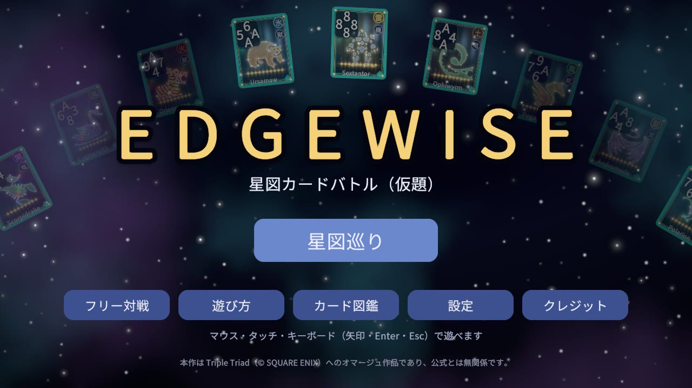
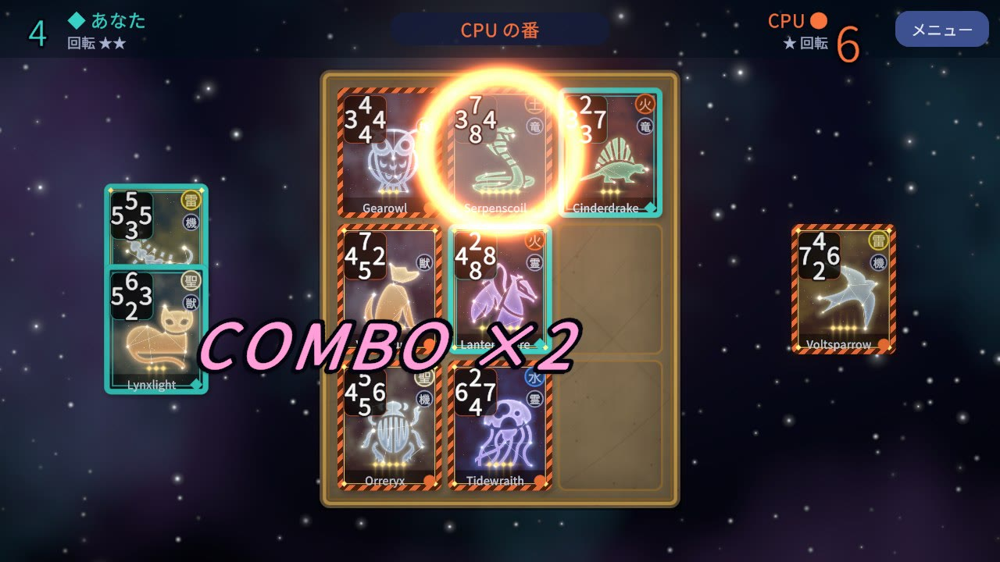
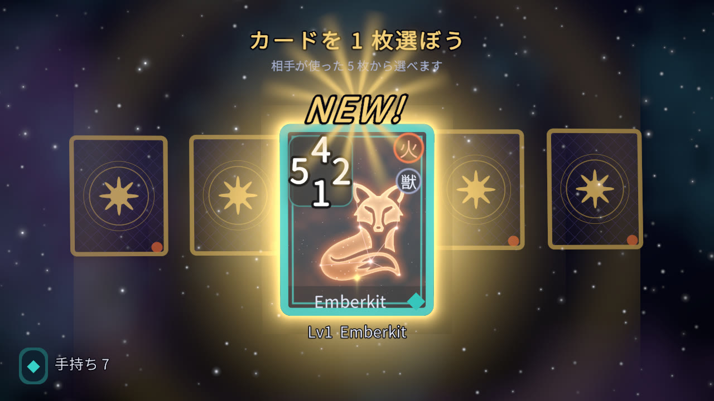
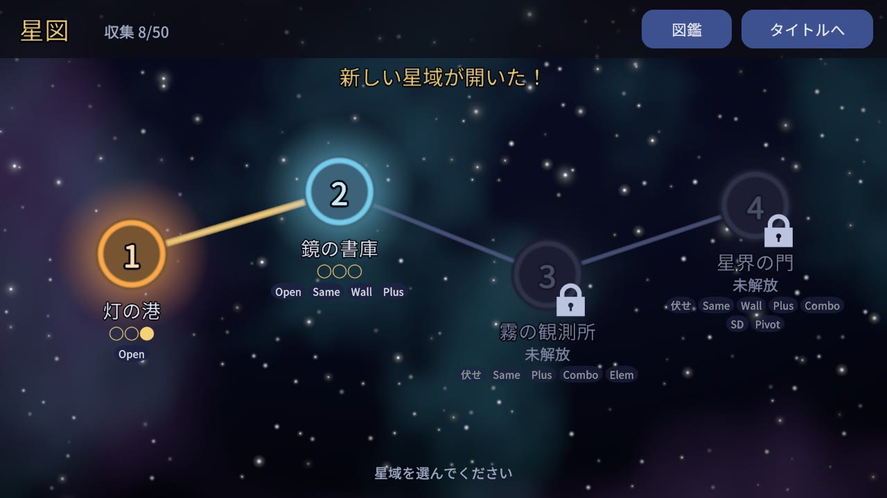
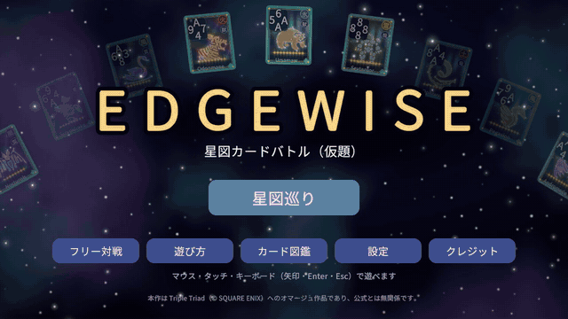

# EDGEWISE（仮題）— 星図カードバトル

> **EDGEWISE** is an original browser card battle built with **Unity 6 / C#**, an homage to the rules of FF8's Triple Triad (all cards, names and art are original).
> A deterministic rules engine that runs outside Unity (296 NUnit tests, verified against a TypeScript reference over 975 games), an alpha-beta CPU that never peeks at hidden cards, and balance tuned by self-play simulation.
> Play it in the browser: GitHub Pages / unityroom (links below). A single-player campaign (4 regions, 12 opponents) and a free match mode are included.

3×3 の盤にカードを置き、隣の相手カードより大きい数字の辺で裏返して陣地を取り合う対戦カードゲームです。Triple Triad（FF8）のルールの仕組みへのオマージュで、カード・名前・絵・音はすべてオリジナル（または出典を明記したフリー素材）です。

- **ブラウザで遊ぶ（GitHub Pages）**: https://magu0914.github.io/edgewise/
- **ブラウザで遊ぶ（unityroom）**: {{UNITYROOM_URL}}
- リポジトリ: https://github.com/magu0914/edgewise

| | |
|---|---|
|  |  |
|  |  |



## 遊び方

- 手札 5 枚を 1 枚ずつ交互に 3×3 の盤へ置きます。置いたカードの辺が、隣の**相手カード**の向かい合う辺より大きければ、そのカードは自分の色に裏返ります。
- 9 マスが埋まったら終わり。盤の上と手札に残った自分のカードが多い方の勝ちです。
- **Pivot（本作オリジナル）**: 置く前にカードを 90° ずつ回し、強い辺を相手に向けられます（回数に限りあり）。
- Same・Plus・Combo などの追加ルールは、対戦中の「メニュー」→「ルール確認」で確かめられます。タイトルの「遊び方」にも図解があります。
- 操作: ドラッグ＆ドロップ、またはカード → マスの順にタップ。キーボードは矢印で選んで Enter、回転は Q / E（右クリック・画面のボタンでも可）。スマホの縦画面でも遊べます。
- **オンライン対戦**: フリー対戦の設定画面から部屋を作り、6 文字の部屋コードか招待 URL を相手に送ると、ブラウザ同士（WebRTC / PeerJS の P2P）で対戦できます。ネットワーク環境によってはつながらない場合があります。
- **星図巡り**（一人用）: 4 つの星域の 12 人と戦い、勝つと相手のカードを 1 枚もらえます。デッキは星域ごとの合計レベルの上限内で組みます。**フリー対戦**は全カード・ルールを自由に選べます。
- **オンライン対戦**（フリー対戦の設定画面から。WebGL 版のみ）: 「部屋を作る」で出る部屋コードか招待 URL を相手に送ると、ブラウザどうしで直接つながって対戦できます（アカウント不要。通信は PeerJS の WebRTC）。会社や学校のネットワークなど、**つながらない環境があります**。Open OFF でも、ホストの端末には相手の手札のデータがあるため、気楽な対戦向けです。CPU とヒントは使えません。

## 見どころ（技術）

- **Unity に依存しない決定論的なルールエンジン**（`Assets/Game/Core`、asmdef の `noEngineReferences`）。同じソースを Unity と dotnet の両方でビルドし、dotnet の NUnit で **296 件**のテストを Unity を起動せずに回します（GitHub Actions でも実行）。
  移植元の TypeScript 版とは、**975 局**の全手について局面のハッシュ・イベント列・合法手を突き合わせて一致を確かめています（`dotnet/Edgewise.Core.Tests/Golden`）。乱数は mulberry32、浮動小数点は使いません。
- **αβ 探索の CPU**: 反復深化 αβ ＋置換表（Zobrist）＋手順序付け。探索は「一定ノードずつ進める」形で、WebGL（スレッドなし）では 1 フレーム 6 ms ずつ進めます。WebGL 上で Hard の 1 手は平均 0.13 秒・最大 0.32 秒、思考中も 59〜60 FPS（`docs/BALANCE.md`「速度」）。
  相手の手札が伏せられているときは、見えていないカードから手札をサンプリングする**決定化**で読み、**相手の本当の手札だけが違う 2 つの局面で同じ手を選ぶ**ことをテストで保証しています（盗み見ない）。強さは Hard 対 Easy で 96.4%（Open ON）／ 89.6%（Open OFF。見えない情報による頭打ちを補足実験で確認）。
- **自己対戦によるバランス調整**（`dotnet/Edgewise.Sim`。配牌を席交代で 2 回ずつ、Wilson の 95% 信頼区間つき）:
  - Pivot は「両者 2 回」だと Hard 同士の先攻勝率が 74.8%（原因の切り分けでは 80.6%）に偏りました。候補を比べ、**先攻 1・後攻 2 回**で 48.2%、Sudden Death ON は 1・1 回で 53.0% にしました（目標 45〜55%）。
  - 星図巡りは、各相手に「その時点の標準的な手持ち」で挑んだときの勝ち・引き分け・負けの割合を測り、相手の持ちカードと AI の強さを調整して、主 4 人の目標（例: 星域 1 の主は勝ち 55〜70%）に 2 つの seed で収めました。
- **SDF とシェーダーによるカード絵**: game-icons.net のシルエット（SVG）をマスク → SDF のアトラスにし、星雲・星座・レベルごとのホロ加工・傾きに連動する光沢をシェーダーで重ねています。50 枚＋立ち絵 12 人をエディタのパイプラインで何度でも再生成できます（`docs/ART.md`）。
- **イベント列を再生する演出の設計**: エンジンは 1 手を解決して `place / rule / flip / turn / end ...` のイベント列を返すだけで、表示側（`EventPlayer`）はそれを Unity 6 の `Awaitable` で順に再生します。表示側はルールを判断しません。置く前の予告（裏返るカードが光る）もエンジンを局面のコピーに当てるだけです。
- シーンは Editor スクリプトがコードから生成し、fileID を決定論的に振り直すので、作り直しても差分が出ません。日本語フォントは使う文字だけを焼いた静的 SDF です。

## 見どころ（ゲームデザイン）

- **Pivot（オリジナル）**: 「強い辺をどこへ向けるか」と「限られた回数をいつ切るか」の判断を足し、手札が弱くても逆転の目が生まれるようにしました。先攻有利を打ち消す側に効くよう、回数を非対称にしています（上記）。
- **星図巡り**: 原作の面白さの核「相手ごとのルールで戦い、勝ってカードが増え、デッキが育つ」を 1 本の流れにしました。
  - 星域ごとの固定ルール（基本 → Same/Plus → 伏せ札・属性・Combo → Pivot・Sudden Death）と、デッキの**合計レベルの上限**（どの 5 枚で挑むかのナップサック的な悩み）。
  - 相手ごとの**性格**（角を好む、Same/Plus を狙う、Pivot を早めに切る など）を探索のルート選択にだけ効かせ、難易度の順は崩さない。
  - 初回の登場台詞で、その星域の新しいルールを 1 行だけ手ほどきする（説明書を読まなくてもわかるように）。主とは決着がつくまで（Sudden Death）。

- **Resonance と Trait（オリジナルの追加ルール）**: 同じ系統の自分のカードと隣り合うと全辺 +1 になる Resonance と、Lv7〜10 の 12 枚に付く固有能力 4 種（Guard / Pierce / Rally / Anchor）。どちらもフリー対戦の選択ルールで、割り当てと Pivot との兼ね合いは自己対戦の数値で決めました（13 条件中 12 条件で先攻勝率 45〜55%）。
- **オンライン対戦の同期**: 両者が同じ seed から決定論的なエンジンで同じ局面を作り、手（Move）と手の後の局面ハッシュだけを送ります。食い違い・手の抜けは検出して中断し、切断は 30 秒の再接続待ちのあと不戦勝です。

## 設計資料

- [`docs/DESIGN.md`](docs/DESIGN.md) — 設計の単一の真実（ルール・エンジン・AI・演出・星図巡り・公開）
- [`docs/BALANCE.md`](docs/BALANCE.md) — 自己対戦の数値と、数値を決めた理由
- [`docs/ART.md`](docs/ART.md) — カード絵と立ち絵のパイプライン
- [`docs/AUDIO.md`](docs/AUDIO.md) — BGM の入れ方 ／ [`docs/PUBLISH.md`](docs/PUBLISH.md) — 公開の手順

## 開発の進め方

個人制作です。AI エージェント（Anthropic の Claude / Claude Code）と次のように分業しました。

- **magu（作者）**: 企画、仕様の判断（何を作るか・どれを採用するか）、試遊とフィードバック、公開の判断。
- **メインの AI セッション**: 設計（`docs/DESIGN.md` の執筆・改訂）と、実装・数値・画面の監査。
- **サブエージェント（Claude Code）**: 実装、テスト、自己対戦の計測、スクリーンショットや E2E の実行。

コードとドキュメントの大部分は AI エージェントが書いています。品質は、設計書との突き合わせ、自動テスト（dotnet 296 件・Unity の EditMode 110 件・PlayMode 32 件）、ヘッドレス Chrome での WebGL の E2E、自己対戦の数値、magu の試遊で確かめました。

## ビルド方法

- **Unity 6000.3.15f1**（URP 2D）。リポジトリのルートが Unity プロジェクトです。
- コアのテスト（Unity 不要）: `dotnet test dotnet/Edgewise.sln`
- Unity の batchmode は PowerShell から `tools/RunUnity.ps1` 経由で呼びます。
  ```powershell
  # シーン・フォント・カード絵の生成（何度実行しても同じ結果）
  & .\tools\RunUnity.ps1 -LogName setup.log -Extra '-executeMethod','Edgewise.EditorTools.ProjectSetup.Run'
  # WebGL（GitHub Pages 用）→ Builds/WebGL
  & .\tools\RunUnity.ps1 -LogName build.log -Extra '-buildTarget','WebGL','-executeMethod','Edgewise.EditorTools.BuildScript.BuildWebGL'
  # unityroom 用（Gzip・Decompression Fallback オフ）→ Builds/unityroom
  powershell -ExecutionPolicy Bypass -File tools/package_unityroom.ps1
  ```
- **BGM は別途入手が必要です**。曲のライセンス上、曲ファイルはリポジトリに含めていません（クローン直後は無音で動きます）。入手先と置き方は `docs/CREDITS.md` と `docs/AUDIO.md`。
- 自己対戦: `dotnet run -c Release --project dotnet/Edgewise.Sim -- --match hard:easy --rules default --deals 1000 --seed 2026`（表を再現するコマンドは `docs/BALANCE.md`）。

## クレジットとオマージュの表記

本作は Triple Triad（© SQUARE ENIX）へのオマージュ作品であり、公式とは無関係です。ルールの仕組みのみを参考にし、カード名・キャラクター・絵・音・ロゴ・名称は使っていません。

カード絵の土台は [game-icons.net](https://game-icons.net)（CC BY 3.0。Lorc, Delapouite, Caro Asercion, Skoll, Cathelineau）、BGM は [OpenTracks](https://opentracks.com/) のフリー素材、フォントは Noto Sans JP（SIL OFL 1.1）です。効果音はすべてプログラムで合成しています。詳細は [`docs/CREDITS.md`](docs/CREDITS.md)。
